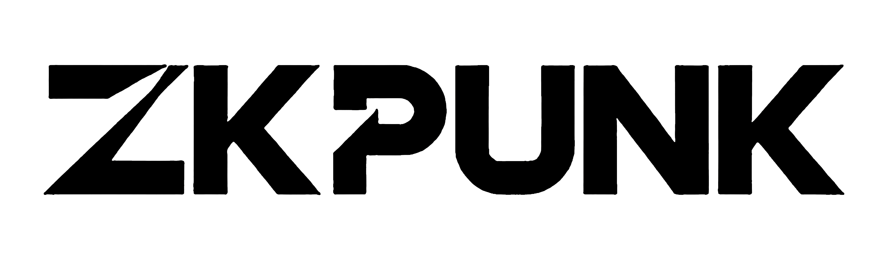

  

  

# ZKPedia

ZKPedia is a community-maintained knowledge base for zero-knowledge proofs, published by [ZKPunk](https://zkpunk.pro). It collects long-form, technically serious writing about ZK — the kind that walks you through a protocol step by step instead of stopping at the analogy — and keeps it free to read.

Most of that writing was first published in Chinese, and a good part of it still has no English equivalent anywhere. This English edition exists to close that gap, one series at a time. It is a work in progress, and it is honest about where the gaps are: chapters greyed out in the sidebar are not translated yet.

## Where to start

If you are new to zero-knowledge proofs, read **Exploring Zero-Knowledge Proofs** by Yu Guo. It is the series that most Chinese-speaking ZK engineers learned from, and the first three parts are now available in English. It builds up the intuition behind simulation, knowledge extraction and the random oracle without hand-waving, and it assumes only undergraduate mathematics.

If you already work with proof systems and want reference material, the **halo2 Q&A** is a curated distillation of the halo2 Discord and is already in English.

## What is still Chinese-only

The library also holds several deep series that have never been translated: *Understanding PLONK* and *Understanding Lasso* by Yu Guo, *Learning zk-SNARKs from Scratch*, a full halo2 tutorial, and a lattice cryptography track. You can read all of them in the [Chinese edition](https://learn.zkpunk.pro/), and machine translation handles them tolerably well — but they deserve better, and that is exactly the work we are asking for help with.

## Help translate

Translating one article is a genuinely useful contribution, and it does not require you to be a cryptographer — it requires you to read Chinese and to care about getting the mathematics right. See [Contribute a translation](./how-to-contribute.md) for how the English edition is laid out and how to open your first pull request.

## Other things ZKPunk publishes

[ZK Insights](https://insights.zkpunk.pro) is a weekly roundup of the ZK field, covering new papers, protocol releases and project updates. The [ZK Academy](https://github.com/Antalpha-Labs/zkp-academy) courses cover PLONK and FRI & STARK in depth.

  <h4 align="center">Thank you to everyone who has contributed</h4>
  

