# Random "Challenges"

*Exploring Zero-Knowledge Proofs Series (Part 4)*

[TOC]

> "Challenges are at times an indication of Lord's trust in you."  
> — **D. Todd Christofferson**

> Author: **Yu Guo @ SECBIT** (郭宇), <https://github.com/sec-bit>  
> Original (Chinese): <https://github.com/sec-bit/learning-zkp/>

This article continues our long discussion of the machinery behind zero-knowledge proofs, in the hope of giving you a rough map of this family of "modern cryptographic tools". It runs to roughly 8,000 words in the original, with a small amount of mathematics.


## Interaction and Challenges

Every zero-knowledge proof system we have looked at so far has been *interactive*: the verifier, Bob, has to supply one or more random numbers during the conversation as challenges. In the map three-colouring problem (see Part 2), Bob has to keep picking a random edge to challenge Alice's answer, over and over, until he is satisfied — and Alice's probability of cheating decays *exponentially*. The whole basis for Bob's belief rests on whether the random numbers he picks are random enough. If Alice can predict Bob's randomness in advance, disaster follows: the Real World collapses into the Ideal World, Alice is promoted on the spot to a simulator, and she can use her superpowers to fool Bob.

In Part 3 we analysed the Schnorr protocol. There, Bob only needs to pick a single random number `c` to challenge Alice and have her compute a value `z` — but Bob must never let Alice gain any knowledge about `c` in advance, or Alice, too, turns into a simulator.

The importance of randomness needs no further argument:

> Challenging with random numbers is the foundation of trust in an interactive zero-knowledge proof.

But interaction limits where these protocols can be used. What if we could turn an interactive zero-knowledge proof into a *non-interactive* one? That would be very, very exciting. "Non-interactive" here means a proof that takes a single round: Alice simply sends a proof to Bob, and Bob verifies it.

Non-Interactive Zero Knowledge, or NIZK, means the entire proof is encoded as a *string*. You can write it on a piece of paper, send it to any verifier by email or chat, or even put it on GitHub for anyone to download and check.

In the blockchain world, NIZK can be part of the consensus protocol, because a transaction **has to be validated by many miners**. Imagine if the sender of a transaction had to interact with every single miner and let each one issue challenges — consensus would be unbearably slow. A non-interactive zero-knowledge proof, by contrast, **can simply be broadcast to every mining node**, and each one verifies it on its own.

Some readers may ask: wouldn't it be enough for just one miner to do the challenging? Encode the interaction transcript between that miner and the sender as a proof, broadcast it to the other miners, and have them trust that the challenge was honest — wouldn't that work? Obviously not: this requires trusting the first miner as a trusted third party. A third party? That doesn't sound like a good idea.

Non-interactive zero-knowledge proofs — from here on, just NIZK — sound ideal by comparison. No third party taking a cut.

## The Puzzle "Non-Interaction" Creates

If NIZK exists, it is considerably more powerful than an interactive proof.

+ An interactive proof can only convince one verifier; a NIZK can convince many verifiers, potentially everyone.
+ An interactive proof is only valid at the moment of interaction; a NIZK is valid forever.

> NIZK travels not only across space, but across time.

Sounds lovely, doesn't it? But...

Let me repeat the conclusion from the previous section:

> Challenging with random numbers is the foundation of trust in an interactive zero-knowledge proof.

So what happens when NIZK throws the challenge process away?

Recall how we proved the "zero-knowledge" property (see Part 2). The proof requires constructing a simulator — an algorithm — that also interacts with the verifier, Bob, but in the Ideal World, and Bob has no way to tell whether he is talking to the real Alice or to a simulator.

Now think about what *non-interactive* means in NIZK. Suppose "I" hand "you" a sheet of paper with a genuine proof `X` written on it, and suppose that after reading it you really are convinced. Because the protocol is zero-knowledge, if you replace "me" with a simulator, the simulator can *forge* a fake proof `Y` that also convinces you.

Here is the problem:

+ How do you tell `X` and `Y` apart — which is genuine and which is fake? You can't, of course. The protocol is zero-knowledge, so you *must* be unable to distinguish them.
+ But then I could just as easily hand you `Y` instead. Doesn't that mean "I" can cheat you?

Something has gone wrong here. Please think about it for two minutes.

(Two minutes later...)

Because NIZK has no interaction, it has no challenge process either. Every part of the proof is computed and written down by Alice, so in principle Alice can write whatever she likes and nobody can stop her — including the fake Ideal-World proof `Y`.

Readers who have really internalised what a simulator is will spot the crucial point here: the simulator must be able to construct `Y` **only** in the Ideal World. Something as wicked as `Y` may exist only in the Ideal World; it must not be allowed out into the Real World to wreak havoc.

Keep thinking...

There is a deeper problem. Recall the map three-colouring protocol. The reason the simulator cannot misbehave in the Real World is that its superpower — rewinding time — exists only in the Ideal World; no such black magic exists in the Real World. The *non-existence* of that power in the Real World is the whole point.

And in NIZK there **is no interaction**, which has a serious consequence: the simulator has no way to use its time-rewinding superpower, and so it apparently cannot separate the prover's behaviour in the two worlds either.

Put differently: faced with any NIZK system, the simulator seems to lose its exalted position. It appears to fall to earth and become an ordinary mortal. And if — I say *if* — we follow that reasoning, then a simulator without superpowers is indistinguishable from Alice, which means Alice can be a simulator too, which means Alice can cheat Bob at will in the Real World, which means the proof system is worthless because it has lost *soundness*. Conclusion: no NIZK can be sound.

Something must be wrong with this argument...

In the analysis above we kept pointing at the missing interactive challenge. It is true that if Bob takes no part in generating the proof, and every bit of the proof comes from Alice, then intuitively there is no foundation on which Bob's trust could rest. That does feel like a contradiction.

So does that mean that without Bob's participation there is *no* way at all to build a foundation of trust? Where else could that foundation come from?

The answer is: a third party!

Wait — isn't the protocol only between two parties, Alice and Bob? Where does a third party come from?

We need to introduce a third party in a special way, and there is more than one way to do it. Let us look at the first.

(Through tears: didn't we just agree that we weren't going to introduce a third party?)

## Revisiting the Schnorr Protocol

Let us look again at our old friend, the Schnorr protocol. It is a three-step protocol: first Alice sends a commitment, then Bob sends a random challenge, then Alice answers the challenge.

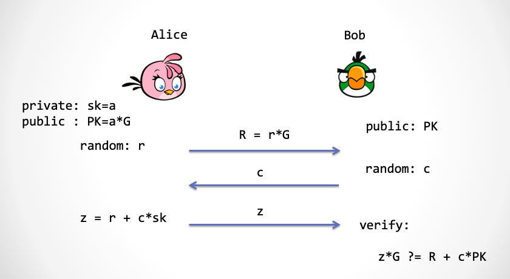

Now, how do we turn a three-step Schnorr protocol into a one-step one?

Look at step two, where Bob has to produce a random challenge `c`. We can instead let Alice compute the challenge with the following formula, which removes step two altogether:

```
c = Hash(PK, R)
```

Here `R` is the elliptic curve point Alice sends to Bob, and `PK` is the public key. Take a good look at this way of computing `c` with a hash function. It achieves two things at once:

1. Alice has no way to predict `c` before she produces the commitment `R`, even though `c` is now, in effect, chosen by Alice.
2. `c` is computed by a hash function, so it is uniformly distributed over an integer range and can serve as a random number (*note: please take this at face value for now; we discuss it more carefully below*).

Note carefully: Alice must never be able to predict `c` before producing `R`. Otherwise Alice effectively acquires the time-rewinding superpower and can fool Bob at will.

A cryptographically secure hash function is *one-way* — SHA256, SHA3, blake2 and so on. So although `c` is computed by Alice, Alice has no ability to cheat by choosing `c`, because as soon as she produces `R`, `c` is effectively fixed. We assume that Alice, a mere mortal in the Real World, cannot invert a hash.

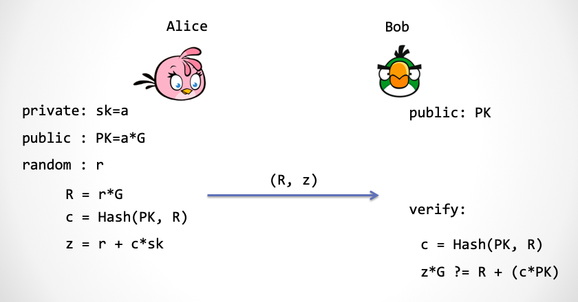

As the figure shows, the hash function lets us collapse the three-step Schnorr protocol into a single step. Alice can send `(R, c, z)` directly. And since Bob already has `PK`, he can compute `c` himself, so Alice only needs to send `(R, z)`.

Reshape this scheme slightly and you get a *digital signature*. A digital signature is this: "I" show "you" a string — say, the line of poetry 「白日依山尽，黄河入海流」 ("The white sun sets behind the mountains; the Yellow River flows on into the sea") — and to prove that this line came from me, I have to sign something. That something must prove that my identity and this line of poetry are bound together.

## Digital Signatures Seen as NIZK

Loosely speaking, a digital signature scheme amounts to proving that (1) I hold the private key, and (2) the private key was involved in a computation tied to the message.

Proving my identity is the easy part: that is exactly what the Schnorr protocol does — it proves to the other party the statement "I hold the private key". And the proof is zero-knowledge: it leaks no knowledge about the private key.

So how do we bind it to that line of poetry? We modify how `c` is computed:

```
m = "白日依山尽，黄河入海流"
c = Hash(m, R)
```

What stops an attacker from forging signatures at will here is precisely the discrete logarithm problem (DLP) together with the assumption that the hash function is second-preimage resistant.

*Note: strictly speaking, to guarantee unforgeability of the signature one needs to show that the Schnorr protocol satisfies a stronger property called "simulation soundness". See reference [2].*

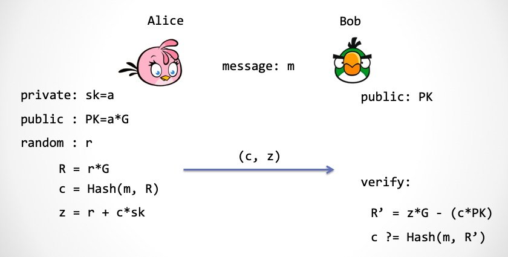

The figure above is the well-known Schnorr signature scheme [1]. There is one more optimisation here: what Alice sends Bob is not `(R, z)` but `(c, z)`, because `R` can be recomputed from `c` and `z`.

*Note: why is this an "optimisation"? The known attacks against elliptic curves — Shanks's algorithm, the lambda algorithm, Pollard's rho algorithm — all have complexity roughly $O(\sqrt{n})$ [3], where `n` is the bit length of the field size. Suppose we use a field very close to `2^256`, so that `z` is 256 bits; then the elliptic curve group is also close to 256 bits, and taking the square root of `2^256` gives `2^128`. In other words a 256-bit elliptic curve group only offers 128 bits of security, so the challenge `c` only needs to be 128 bits. Sending `c` therefore saves space compared with sending `R`, which needs at least 256 bits. Together `c` and `z` come to 384 bits — a saving of `1/4` of very precious space compared with the currently popular ECDSA scheme. The Bitcoin development team has been preparing to replace ECDSA with a Schnorr-like signature scheme, muSig [4], which supports multisignature and aggregation far more flexibly.*

The technique of using a hash function to turn an interactive proof system into a non-interactive one is called the **Fiat-Shamir transform** [5], proposed in 1986 by the cryptographic elders Amos Fiat and Adi Shamir.

## Rebuilding Trust — The Random Oracle Genie

We said earlier that losing the challenge appears to lose the foundation of trust. In the Schnorr signature scheme, the hash function takes over the role of *challenger*, and that role has a very academic name: the **random oracle** [6].

But why a hash function here? What Alice actually needs, when she wants to produce public randomness, is a thing called a random oracle. What is that?

Time to open our minds.

Imagine that in the Real World there is a genie in the sky, holding a two-column table: strings on the left, numbers on the right. Anyone — you, me, Alice, Bob — may send a string up to the genie.

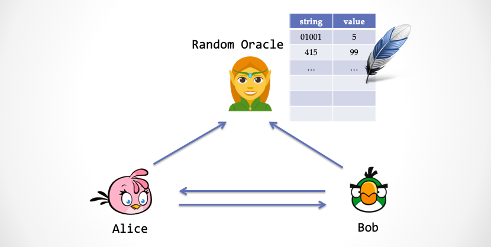

On receiving a string, the genie looks down the left-hand column to see whether the string is already there. Two cases:

+ Case one: the string is not in the left column. The genie generates a *true* random number, writes the string and the number into the table, and returns the number to the mortals below.
+ Case two: the string is already recorded in the left column. The genie simply returns the number sitting in the right-hand column.

You may notice that this genie behaves rather like a random number generator — but with one important difference: if we send the same string twice, it returns the same number. This genie is the fabled random oracle.

And in collapsing the Schnorr protocol, what we really needed was a genie like this, not a hash function. What is the difference?

- A random oracle returns, for each new string, a *true* random number with a uniform distribution.
- A hash function's output is not truly uniformly distributed randomness.

So why did we use a hash function above? Because in the Real World, **true random oracles do not exist!** Why not? Because a hash function cannot possibly produce true randomness: a hash function is a *deterministic* algorithm, and apart from its arguments no other randomness enters.

A cryptographically strong hash function does, however, *seem* able to stand in as a pseudo random oracle. The collapsed protocol therefore needs one extra, rather strong, security assumption:

> Assumption: a cryptographically secure hash function approximately simulates the fabled random oracle.

Because this assumption cannot be proved, we can only trust it — treat it as an axiom, if you like. As an aside, the generalised collision resistance of a hash function is what makes its output usable as randomness, and in many (though not all) cases attacking a hash function is very hard, so plenty of cryptographers use them boldly.

The security model that does *not* use this assumption is called the **standard model**. The model that does use it is not, of course, called the non-standard model — it has a nicer name: the **random oracle model**.

There are two kinds of people in this world: those who like their tofu pudding sweet and those who don't. Likewise, the world's cryptographers come in two kinds: those who like the random oracle model, and those who don't [6].

## Building the Foundation — Kidnapping the Genie

After the Fiat-Shamir transform, the Schnorr protocol has the NIZK property. This is different from the SHVZK we proved earlier: SHVZK requires the verifier to be honest, whereas NIZK makes no unrealistic demands on the verifier at all, because the verifier does not participate in any interaction — the question of requiring an honest verifier simply disappears.

*Note: what if the verifier Bob is dishonest? Then Bob might be able to extract Alice's knowledge. But whether the three-step Schnorr protocol satisfies full "zero-knowledge" is, as of now, unknown. In Part 3 we only proved the weaker property, SHVZK.*

Once the Schnorr protocol transforms itself into a non-interactive zero-knowledge proof system, however, it really is zero-knowledge.

And now your question is probably: that sounds plausible, but can you prove it?

It is time. Cue the simulator.

How do we use the simulator trick to construct an Ideal World here? Think about it: we have previously used "rewinding time", and the power to tamper with Bob's "random number conveyor belt", to let the simulator cheat. But there is no interaction any more, which means the time-rewinding superpower is unavailable, Bob's random number conveyor belt does not exist, and so tampering with the conveyor belt is unavailable too.

> But the simulator must have *some* superpower, or there is no way to build the foundation of trust.

(If the simulator could cheat without any superpower, that would amount to proving the protocol unsound.)

You have probably guessed it: the simulator is going to interfere with the random oracle.

Consider first constructing an Ideal World to prove zero-knowledge. In this Ideal World, the simulator has *kidnapped* the genie who supplies the oracle. When Bob asks the genie for a random number, the genie does not hand over a true random number; it hands over a number that Zlice (the simulator playing Alice) prepared in advance — one that is still uniformly distributed, preserving indistinguishability. The genie has no choice but to return to Bob a number that looks random but has a back door. **The back door is simply that Zlice chose the number herself, ahead of time.**

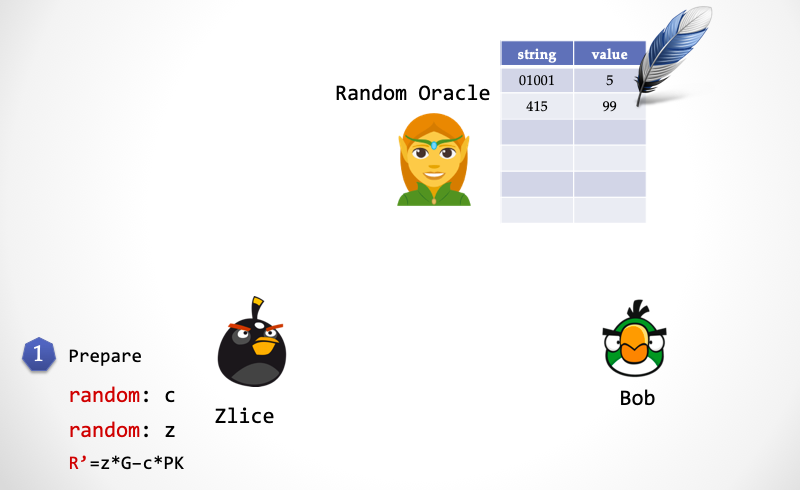

+ Step one: Zlice picks `z` at random and `c` at random, and computes `R' = z*G - c*PK`.

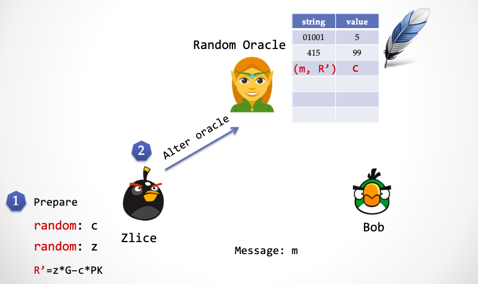

+ Step two: Zlice writes `c` against `(m, R')` in the genie's table.

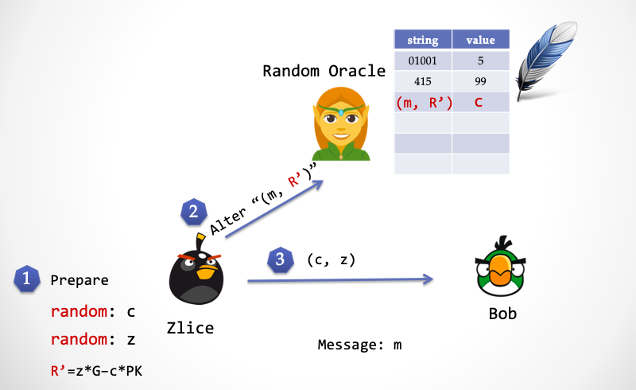

+ Step three: Zlice sends the signature `(c, z)` to Bob.

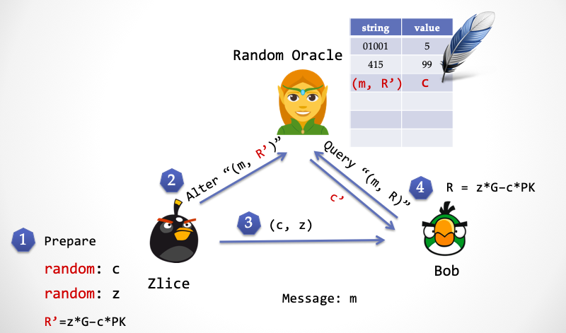

+ Step four: Bob computes `R = z*G - c*PK` and sends `(m, R)` to the genie, which returns `c'`. Note that the `R` Bob computes and the `R'` Zlice computed are equal.

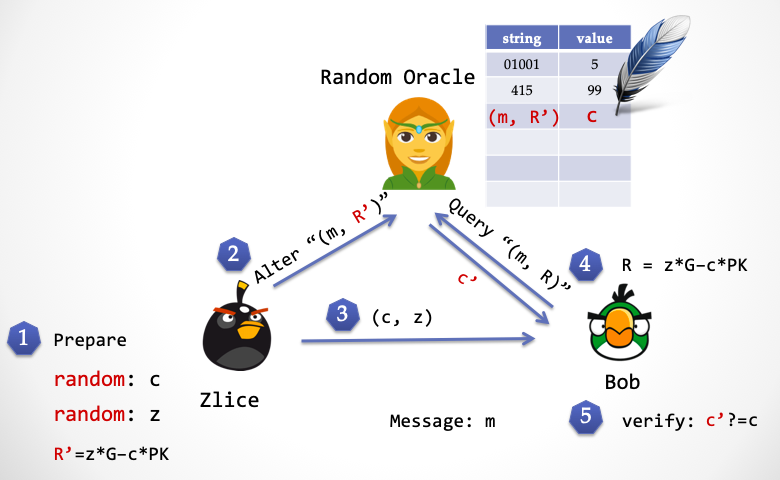

+ Step five: Bob checks whether `c ?= c'` — whether the random number the genie sent back matches the one his counterparty sent. If they match, the signature verifies; otherwise verification fails.

By kidnapping the genie, Zlice can likewise know the random number in advance, achieving the same effect as rewinding time.

We have now shown that the simulator Zlice *exists*, and with that we have proved zero knowledge for our NIZK.

Next we prove the protocol's *soundness*. Imagine a different Ideal World in which a thing called the *extractor* has also kidnapped the genie. When the innocent Alice asks the genie for a random number, the genie returns `c1`, and the extractor peeks at `c1` in the genie's table. After Alice computes `z1`, the extractor can still deploy the time-rewinding superpower, sending Alice back to step two so that she asks the genie for a random number again. The string Alice sends is obviously the same as the first time, `(R, m)`. By rights, since `(R, m)` is already written in the left column of the genie's table, an honest genie should return `c1`. But the extractor has kidnapped the genie, and changes the right-hand column of the `(R, m)` row to a different number, `c2`. Once Alice has computed a second value `z2`, the extractor is done: it recovers Alice's private key `sk` from

```
sk = (z1 - z2)/(c1 - c2)
```

## The Fiat-Shamir Transform — From Public-Coin to NIZK

The Fiat-Shamir transform is not limited to the Schnorr protocol. Any *public-coin protocol* can be compressed by it into a single round of interaction — that is, into a non-interactive proof system. The trick first appeared in Amos Fiat and Adi Shamir's paper "How to Prove Yourself: Practical Solutions to Identification and Signature Problems", presented at Crypto 1986 [5]. It is also sometimes attributed to Manuel Blum [6].

To repeat: in a public-coin protocol the verifier Bob does only one kind of thing — generate a random number and challenge Alice with it. The Fiat-Shamir transform replaces each of Bob's challenges with one call to the random oracle.

In a concrete implementation, the random oracle is realised with a cryptographically secure hash function — you cannot pick just any hash; it must be a cryptographically secure one — and the hash's arguments should be the entire preceding context. The figure below should make the shape of the Fiat-Shamir transform clear quickly.

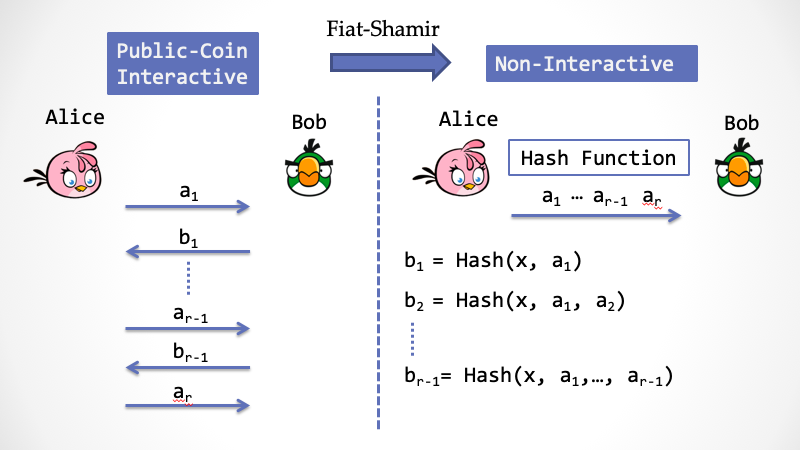

We said earlier that a non-interactive proof system needs a third party to build its foundation of trust, so that Bob can fully believe a proof constructed by Alice. Here, that third party is the genie — in academic jargon, the random oracle. This genie is not a real third party but a virtual one, and it exists in both the Real World and the Ideal World. In the Real World the genie is a conscientious, quietly handsome fellow; in the Ideal World it gets kidnapped by the simulator.

Public-coin protocols have another lovely name: **Arthur-Merlin games**.

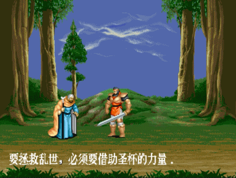

In the picture above, the figure in white on the left is Merlin the wizard, and the handsome one in the middle holding the sword is King Arthur — both from the medieval European legend of Arthur and the Knights of the Round Table.

Arthur is an impatient king who carries a coin with him. Merlin is a wondrous wizard with unbounded computing power. The wizard wants to convince the king that a certain claim is true, so the two hold a conversation; but the king is lazy, and each round he only flips a coin and *challenges* the wizard, who must answer on the spot and must make the king believe the claim after `k` rounds. Because Merlin has magic, every coin Arthur flips is visible to Merlin [7].

This bears a family resemblance to the interactive proof system (`IP`) we mentioned in [Part 1](https://github.com/sec-bit/learning-zkp/blob/master/zkp-intro/1/zkp-back.md), but it is not the same thing. `IP` was formally introduced in 1985 by Goldwasser, Micali and Rackoff (GMR), and its proving power covers a very large class of computational complexity problems. The difference is this: in the definition of `IP`, both the prover and the verifier are Turing machines that can flip coins, and the verifier may flip its coins secretly and hide them from the prover; in an Arthur-Merlin game the king can only flip coins, and moreover the result of every flip is always known to Merlin.

However, the Fiat-Shamir transform can only be proved secure in the random oracle model, and whether realising the random oracle with a hash function is secure has no security proof. Worse, protocols proved secure in the random oracle model may in fact be insecure — counterexamples have been found [8] — and more unfortunately still, S. Goldwasser and Y. Tauman showed in 2003 that the Fiat-Shamir transform itself **has security counterexamples** [9]. None of this means the Fiat-Shamir transform cannot be used; it means you must use it very carefully and never apply it blindly.

Even so, nobody can resist the temptation of the Fiat-Shamir transform, and it is used everywhere. It is worth noting that the various zkSNARK schemes — the hottest general-purpose non-interactive zero-knowledge proofs — are full of Fiat-Shamir transforms. Bulletproofs is one you have probably heard of, and there are less famous general-purpose schemes too: Hyrax, Ligero, Supersonic, Libra and others (which we will unpick one by one in due course).


## Careful: Security Pitfalls in the Fiat-Shamir Transform

In the Fiat-Shamir transform, pay particular attention to the arguments you feed the hash function. Real implementations have shipped with hash arguments missing.

For example, in `A, Hash(A), B, Hash(B)`, the second hash has dropped the argument `A`; the correct form is `A, Hash(A), B, Hash(A,B)`. Mistakes of this kind introduce severe vulnerabilities. In the Swiss electronic voting system SwissPost-Scytl, the implementation of the Fiat-Shamir transform repeatedly omitted arguments that should have been present, with the result that an attacker could not only invalidate votes at will but also forge them, committing electoral fraud [10]. Please be careful when you implement this.

Attentive readers may go back and look at the Schnorr signature and notice that its hash also seems to be missing an argument, `PK` — it is not a strict Fiat-Shamir transform. This is known as the weak Fiat-Shamir transform [11]. In this particular case there is no security problem [3], but kids, don't try this at home.

Some researchers have recently begun studying how to prove the security of the Fiat-Shamir transform rigorously in the standard model. So far they either introduce extra strong assumptions or prove it for one specific protocol, and progress seems limited.

## The Power of Interaction

In 1985, after being rejected several times, the GMR paper was finally accepted at STOC'85 — and another, similar piece of work was accepted at the same conference: "Arthur-Merlin Games: A Randomized Proof System, and a Hierarchy of Complexity Classes" [7], by László Babai of Eötvös Loránd University in Hungary and Shlomo Moran of the Technion in Israel. It introduced public-coin interactive protocols (as the name suggests, the verifier only flips coins in public).

King Arthur's method is simple: challenge Merlin's claim repeatedly at *random*. This matches the intuition we described earlier — random challenges build the foundation of trust. In the paper Babai proved an interesting result: `AM[k] = AM[2]`, where `k` is the number of interactions. Interacting many times turns out to be equivalent to interacting twice — where "twice" means Arthur sends one challenge and Merlin responds.

*Note: there is another class of problems called `MA`, whose interaction order differs from `AM`: in `MA`, Merlin gives the proof first and Arthur then flips coins to check it. It has been proved that the problems `MA` can handle are a subset of `AM`.*

Babai went further and boldly conjectured that `AM[poly]` and `IP` are equivalent. This is a remarkable claim: the king is lazy and only flips a polynomial number of coins, yet this is exactly as expressive as the interactive proof system `IP` described by GMR. Sure enough, at STOC'86 a paper by S. Goldwasser and M. Sipser proved it: `AM[poly] == IP` [12].

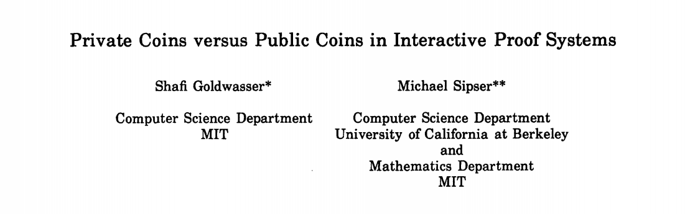

This means that repeated *public* random challenges are enormously powerful — equivalent to an arbitrary interactive proof system. But how `AM[poly]` relates to other complexity classes became the next hot research question.

Three years later, at the end of November 1989 — thirty years ago almost to the day — the young cryptographer Noam Nisan sent an email with a provisional result to a handful of cryptographers, and then left for a holiday in South America. He could not have imagined that this one email would set off one of the fiercest academic races in the field's history. M. Blum, S. Kannan, D. Lipton, D. Beaver, J. Feigenbaum, H. Karloff, C. Lund and many others joined the fight, discussing day and night and racing to publish their results. Finally, on 26 December — exactly one month later — Adi Shamir proved:

> `AM[poly] == IP == PSPACE`


This characterises the notion of "efficient proof" in computational terms, and explains just how much computational power the concept of an interactive proof system covers.

*Note: the class NP is a subset of PSPACE. The former is familiar to most readers; the latter is connected to winning strategies in games such as chess [13].*

L. Babai then wrote an article, "E-mail and the unexpected power of interaction" [14], recounting in detail that whole month of dazzling academic competition conducted "interactively" by email, and the story of interactive proofs.

## The Common Reference String — Another Foundation of Trust

Besides the random oracle, non-interactive zero-knowledge proof systems can use a **common reference string**, or CRS, to accomplish the random challenge. It is a random string produced by a trusted third party before the prover Alice constructs her NIZK proof; the CRS must be produced by a trusted third party and shared with both Alice and the verifier Bob.

Yes, you read that right — a *third party*, again. The third party does not take part in the proof directly, but it must guarantee that the random string was generated in a trustworthy way. The process of producing the CRS is called *trusted setup*, and it is a thing people love and hate in equal measure. Clearly, introducing a third party in a real deployment is a headache. What exactly is the CRS for? And where does the trust in a trusted setup actually go? That is the subject of the next article in this series.

## To Be Continued

The foundation of trust in a non-interactive zero-knowledge proof also requires some form of random challenge. One form hands the challenge to the random oracle genie; the other realises it through a random string shared by Alice and Bob. Both forms fundamentally introduce a third party, and both must provide a back door that the simulator can exploit, so that the simulator has some advantage in the Ideal World — an advantage that must not survive in the Real World.

NIZK radiates endless charm. Again and again I find myself astonished at the exquisite results the pioneers reached over the past thirty-odd years, and at how many unknown corners still wait for a flash of inspiration to light them.

The [GitHub repository](https://github.com/sec-bit/learning-zkp/) for this series received its first pull request, from Jingyu Hu (colortigerhu), changing only a character or two — but in that instant I felt something alive. The exchange of knowledge, the collision of ideas: it is captivating, isn't it?

> "Everyone we interact with becomes a part of us."  
> — **Jodi Aman**

*Acknowledgments: special thanks to Shengchao Ding, Weiran Liu and Yu Chen for their expert advice and corrections, and to the SECBIT Labs team (p0n1, even, aphasiayc, Vawheter, yghu, mr) for their suggested revisions.*

*Acknowledgments: the anecdotes about the cryptographic research race that Nisan set off are drawn from Professor Deng's article [15].*

### References

- [1] Schnorr, Claus-Peter. "Efficient signature generation by smart cards." Journal of cryptology 4.3 (1991): 161-174.

- [2] Paillier, Pascal, and Damien Vergnaud. "Discrete-log-based signatures may not be equivalent to discrete log." *International Conference on the Theory and Application of Cryptology and Information Security*. Springer, Berlin, Heidelberg, 2005.

- [3] Pointcheval, David, and Jacques Stern. "Security arguments for digital signatures and blind signatures." *Journal of cryptology* 13.3 (2000): 361-396.

- [4] Maxwell, Gregory, Andrew Poelstra, Yannick Seurin, and Pieter Wuille. "Simple schnorr multi-signatures with applications to bitcoin." *Designs, Codes and Cryptography* 87, no. 9 (2019): 2139-2164.

- [5] Fiat, Amos, and Adi Shamir. "How to prove yourself: Practical solutions to identification and signature problems." Conference on the Theory and Application of Cryptographic Techniques. Springer, Berlin, Heidelberg, 1986.

- [6] Bellare, Mihir, and Phillip Rogaway. "Random Oracles Are Practical: a Paradigm for Designing Efficient Protocols." *Proc. of the 1st CCS* (1995): 62-73.

- [7] László Babai, and Shlomo Moran. "Arthur-Merlin games: a randomized proof system, and a hierarchy of complexity classes." Journal of Computer and System Sciences 36.2 (1988): 254-276.

- [8] Canetti, Ran, Oded Goldreich, and Shai Halevi. "The random oracle methodology, revisited." Journal of the ACM (JACM) 51.4 (2004): 557-594.

- [9] Shafi Goldwasser, and Yael Tauman. "On the (in)security of the Fiat-Shamir paradigm." *44th Annual IEEE Symposium on Foundations of Computer Science, 2003. Proceedings*. IEEE, 2003.

- [10] Lewis, Sarah Jamie, Olivier Pereira, and Vanessa Teague. "Addendum to how not to prove your election outcome: The use of nonadaptive zero knowledge proofs in the Scytl-SwissPost Internet voting system, and its implications for cast-as-intended verification." *Univ. Melbourne, Parkville, Australia* (2019).

- [11] Bernhard, David, Olivier Pereira, and Bogdan Warinschi. "How not to prove yourself: Pitfalls of the fiat-shamir heuristic and applications to helios." *International Conference on the Theory and Application of Cryptology and Information Security*. Springer, Berlin, Heidelberg, 2012.

- [12] Goldwasser, Shafi, and Michael Sipser. "Private coins versus public coins in interactive proof systems." *Proceedings of the eighteenth annual ACM symposium on Theory of computing*. ACM, 1986.

- [13] Papadimitriou, Christos H. "Games against nature." *Journal of Computer and System Sciences* 31.2 (1985): 288-301.

- [14] Babai, László. "E-mail and the unexpected power of interaction." *Proceedings Fifth Annual Structure in Complexity Theory Conference*. IEEE, 1990.

- [15] Yi Deng. "零知识证明：一个略显严肃的科普" (Zero-Knowledge Proofs: A Slightly Serious Introduction). https://zhuanlan.zhihu.com/p/29491567
