# Burying "Secrets"

*Exploring Zero-Knowledge Proofs Series (Part 5)*

[TOC]

> Once exposed, a secret loses all its power.  
> — **Ann Aguirre**

> Author: **Yu Guo @ SECBIT** (郭宇), <https://github.com/sec-bit>  
> Original (Chinese): <https://github.com/sec-bit/learning-zkp/>

This is the fifth article in the series, and it goes further into non-interactive zero-knowledge proofs. The original runs to about 12,000 words.

**Outline**

1. The past and present of the CRS
2. The Hamiltonian cycle problem
3. Secrets in the cloud: hidden bits
4. Upgrading the randomness
5. The FLS transform: from hidden bits to NIZK
6. In search of an ideal trapdoor permutation
7. NIZK proofs vs. NIZK arguments
8. A world without secrets

If you have followed the series this far you should by now have a rough picture of zero-knowledge proofs. Have you ever asked yourself *why* zero-knowledge proofs work at all? Take a moment to think about it — the map three-colouring procedure in [Part 1](https://github.com/sec-bit/learning-zkp/blob/master/zkp-intro/1/zkp-back.md) is a good thing to hold in mind. (Three minutes pass.) Two ingredients **seem** to be indispensable:

1. *Interaction*: the verifier challenges repeatedly, driving the prover's probability of cheating down to something negligible.
2. *Hidden randomness*: the verifier produces random numbers the prover cannot predict, and challenges with them.

But how does a non-interactive zero-knowledge proof — a NIZK — achieve either of these? In [Part 4](https://github.com/sec-bit/learning-zkp/blob/master/zkp-intro/4/zkp-rom.md) we saw how the random oracle plays the part of a virtual *third party*, giving us virtual interaction and virtual random challenges. This article goes into a second method: removing both interaction and hidden randomness by means of a shared string. That string must be produced at random by a third party in advance, and it is the fabled **common reference string**, or CRS.

## The Past and Present of the CRS

Suppose we use no other machinery and restrict the prover and the verifier to a *single* round of interaction. Then the only things they can prove in zero knowledge are trivial statements — the complexity class `BPP` (Bounded-error Probabilistic Polynomial time), which is generally conjectured to be equal to `P`, though this remains open and unproved. (Think of `BPP` as `P` + randomness.)

*Note: if the prover and verifier interact only once, then in such a NIZK system it is easy to build a decision procedure — `Verify(x, Sim(x))` — that both proves and refutes theorems, so only trivial statements in BPP can be proved.*

Trivial statements can be proved in zero knowledge, but the exercise is pointless. Why? Because the verifier can simply solve for the secret input from the output in polynomial time. The verifier can find it — but the *proof* itself gave the verifier no additional knowledge. Put another way, the verifier knew the statement was true without the prover proving anything, so of course the process was zero-knowledge.

When we talk about zero-knowledge proofs, then, we need to be talking about `NP` problems, which carry *knowledge*. As everyone knows, `P` is the class solvable in polynomial time by a *deterministic* Turing machine, whose execution path on input `x` is a linear sequence of state transitions. `NP` is the class solvable in polynomial time by a *non-deterministic* Turing machine — a machine whose next step is not determined, but chosen among many options, and which solves `x` as long as *some* execution path reaches an accepting state. Its execution trace is a tree. If we record the choice made at each step of that non-deterministic machine — this record of the execution path is the `witness`, which is what we have been calling *knowledge* all along — and hand `(x, witness)` to a deterministic Turing machine, that machine can also solve `x` in polynomial time.

Let me stress this again: knowledge increases a Turing machine's power to solve problems.

`NP` problems contain a `witness` that we do not want leaked to the verifier. In an interactive proof system, therefore, the prover and the verifier hold *unequal* amounts of knowledge.

To guarantee that the proof process is zero-knowledge, we need to guarantee that **the simulator and the verifier are unequal**. But the simulator has no `witness` — so how can they be unequal? In the previous article we introduced the random oracle and created the inequality by letting the simulator kidnap the random oracle genie. This article explains how to create it with a CRS.

The CRS is a random string, published before the proof begins and shared between prover and verifier. How do we use it? Intuitively, a string that both sides *know* does not create any knowledge inequality at all.

The first thing that comes to mind is to use the CRS directly as the random challenge — to let the CRS play the part of the random oracle genie. That does not work.

Why not? Because the CRS is generated before the proof. If the prover knows all the random challenges in advance, the challenges obviously lose all meaning.

*Note: recall how the random oracle guarantees that the prover cannot predict the random challenge in advance. If that is not clear, please reread Part 4.*

> The CRS's mission is to make the simulator and the verifier unequal. How? By hiding some *secrets* inside it.

And what good does hiding a secret do? Plenty: it is what lets the simulator and the extractor play happily in the Ideal World — that is, acquire their superpowers.

In 1988, three pioneers — Manuel Blum, Paul Feldman and Silvio Micali — published "Non-Interactive Zero-Knowledge and Its Applications" [BFM88], showing that neither interaction nor hidden randomness is necessary. They gave a NIZK proof system for the map three-colouring problem, with the help of a shared randomly generated string, i.e. a CRS.

Although... I probably shouldn't mention that their scheme needs a CRS of length about `n^4`, where `n` is the length of the statement being proved.

In 1990, Uriel Feige, Dror Lapidot and Adi Shamir proposed another NIZK construction for NP languages [FLS90]. Unlike [BFM88], this one is not based on any specific number-theoretic assumption but on a cryptographic primitive: the trapdoor permutation. In it, FLS introduced the notion of **hidden bits** and buried the hidden bits inside the CRS. The simulator can then produce its simulation by modifying the hidden bits in the CRS, which is exactly the advantage it needs over the verifier. This scheme, however, needs an even longer CRS — over `k * n^5`, where `k` is the security parameter.

The hidden-bits idea was picked up by many people afterwards. Notably, Kilian and Petrank found a cleverer way to use hidden bits [KP98] (the margin is too small to contain it :), successfully cutting the CRS length down to `k * n^2`. Later J. Groth optimised further, shrinking the CRS to roughly `k * n` [Groth10a].

Apart from hidden bits, J. Groth, R. Ostrovsky and A. Sahai [GOS06] built NIZK from the homomorphic encryption scheme of Boneh-Goh-Nissim [BGN05] or Boneh-Boyen-Shacham. They treat the encryption scheme's *public key* as the CRS; the prover encrypts to form the proof, and then uses homomorphic properties to prove another NP-complete problem, Boolean circuit satisfiability. The great advantage of this scheme is that the CRS has fixed length, since it is only a key — length `k`. The simulator can use its superpower to obtain the trapdoor corresponding to that public key, so that it can seal any message and still obtain the same ciphertext; and the extractor can use its superpower to obtain the private key, so that it can decrypt the proof and recover the knowledge.

In 2010, Jens Groth proposed a new NIZK argument scheme based on the Knowledge of Exponent Assumption (KEA) and pairings [Groth10b], and this is the starting point for a great many later zkSNARK constructions. Here the CRS consists of pairs (`g^x^n`, `g^⍺x^n`) used to implement *knowledge commitments*. The values `x` and `⍺` are two random numbers that must be *forgotten* once the CRS has been generated. Some people call these forgettable random numbers "toxic waste", which rather misleads the reader: they are neither toxic nor harmful, and in fact they are extremely useful. They are the *secrets* buried in the CRS, and they are the simulator's weapon. If the simulator obtains `x` and `⍺`, it can forge proofs, which is exactly what guarantees zero knowledge. As for the extractor, it can extract knowledge directly through the extraction function built into the KEA assumption.

The more recent Sonic scheme [MBK+19] builds on [Groth10b] to achieve an *updatable* CRS. If anyone is worried that the secret in the CRS has already leaked, they can patch the existing CRS and bury one more secret inside it, which restores the CRS's security. This CRS is also *universal*: it is generated once and then serves all statements. The approach was subsequently adopted by the newest schemes, PLONK [GWC19] and Marlin [CHMMVW19].

Next, let us start from a simple example and understand how to build a NIZK on top of a CRS. Before that, we need to introduce an NP-complete problem: the Hamiltonian cycle problem.

## The Hamiltonian Cycle Problem

Picture a map with a number of cities, some pairs of which are joined by roads.

Suppose I hand you such a map and ask you to find a route that traverses every road exactly once. (Suppose every road is a parkway as pretty as a postcard — or, if you prefer, that you want to eat at every roadside McDonald's exactly once, out of some kind of sentiment.) You will probably perk up immediately: isn't this the "draw it in one stroke" puzzle from childhood? Deciding whether a map can be drawn in one stroke is a primary-school maths problem. Count the roads meeting at each city and classify the cities as *odd* or *even* by parity. If a map has exactly two odd cities, then you can only start at one of those odd cities, traverse every road, and end at the other one. Such a route is called an **Euler path**.

If every city in the map is even, then you can start anywhere, easily find a route that traverses every road exactly once, and return to your starting point. That circuit is called an **Euler circuit**.

And if the map has more than two odd vertices, no Euler circuit exists — as in the famous Seven Bridges of Königsberg.

The Seven Bridges of Königsberg problem asks exactly this: can you cross the seven bridges below without repeating any of them?

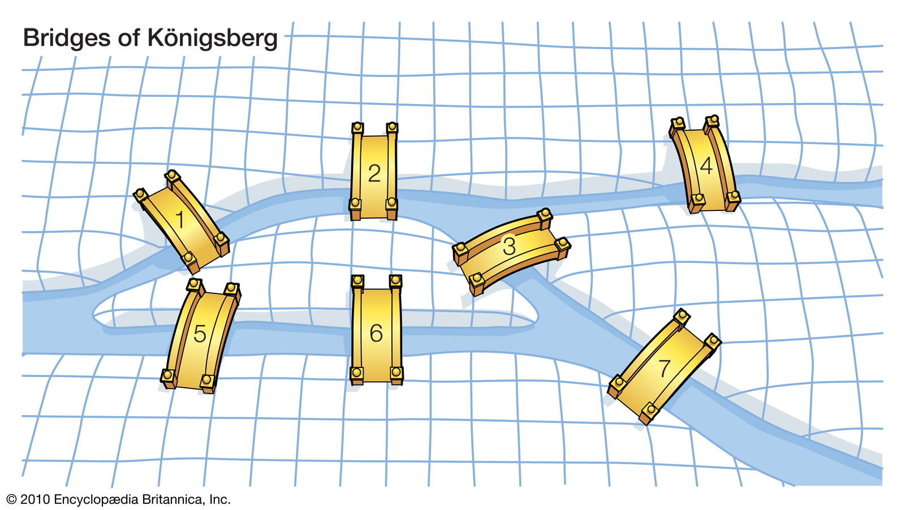

The Königsberg map clearly has several odd vertices, so no Euler path exists. Given any map, deciding whether an Euler circuit exists is a `P` problem — a computer can find one in `poly(n)` time.

*Note: the algorithm for finding an Euler circuit is called Fleury's algorithm.*

For a `P` problem like this, if a prover wants to prove that he knows an Euler circuit, he can simply send the circuit in the clear and let the verifier check it. Note that this process is still zero-knowledge, because the verifier gains no **additional knowledge** from what the prover sent. In other words, seeing the circuit did not increase the verifier's computational power, since the verifier could have computed the Euler circuit itself.

The **Hamiltonian cycle problem** that we actually want to discuss, by contrast, is an `NP` problem:

**Does a map contain a cycle that passes through every city exactly once?**

Take this map, for example:

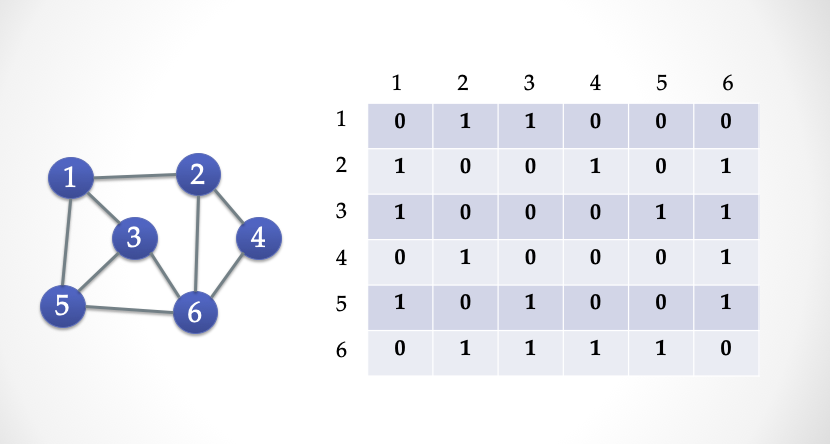

We represent the map by a `V * V` matrix: whenever two cities `(A, B)` are joined by a road, we put a `1` at `(A, B)` and at `(B, A)`, and `0` otherwise. This matrix is called the **adjacency matrix**, and we can flatten it into a string of `0/1` bits.

Finding a Hamiltonian cycle is `NP-complete` — in other words, there is no algorithm that lets a computer find the cycle in `poly(n)` time. But a computer *can* check in polynomial time whether a given path is a Hamiltonian cycle. The map above, for instance, contains a directed Hamiltonian cycle, and one glance is enough to confirm that it does pass through every city. If a map has a Hamiltonian cycle, its matrix must have this feature: every row contains exactly one `1`, and every column contains exactly one `1`.

*Translator's note: strictly speaking, no such algorithm is **known**; its non-existence would follow from P ≠ NP, which is still open — as the closing section of this very article discusses.*

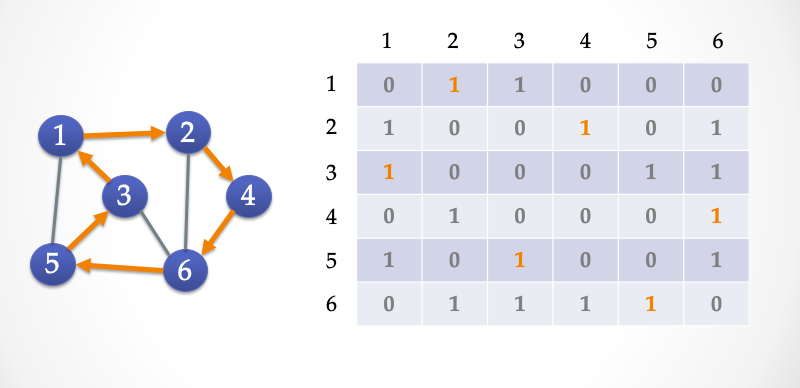

### The ZK-HAM Protocol

Below is a three-step `Sigma` protocol in which Alice proves to Bob that she *knows* a Hamiltonian cycle in the map `G` above.

- Public input: `G`, a map with 6 vertices, represented as a `6*6` adjacency matrix
- Secret input: `C`, a Hamiltonian cycle in `G` (the orange roads in the figure)

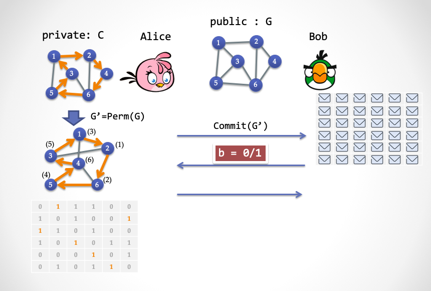

- Step one: Alice picks a random *permutation* `Perm(.)` and uses it to produce a new graph `G'`. She then encrypts every cell of the `G'` matrix and sends the resulting matrix to Bob.

> **Terminology.** A permutation can be pictured as dragging the vertices of the graph around with your **mouse**: the edges follow the vertices as they move, and after renumbering the resulting graph you get `G'` — see the two graphs on the left of the figure above. A graph and its permutation are **isomorphic**. In the lower figure, the number in angle brackets at each vertex is that vertex's label in the upper figure before the drag. More formally: `Perm()` is a bijection from `{1, V}` to `{1, V}`, and in the adjacency matrix of the new graph `G'` we have `[perm(i), perm(i+1)] = 1` if and only if `[i, i+1] = 1`, where `i` is a vertex label and `V` is the number of vertices.

- Step two: Bob picks `b in {0, 1}` at random as his challenge.

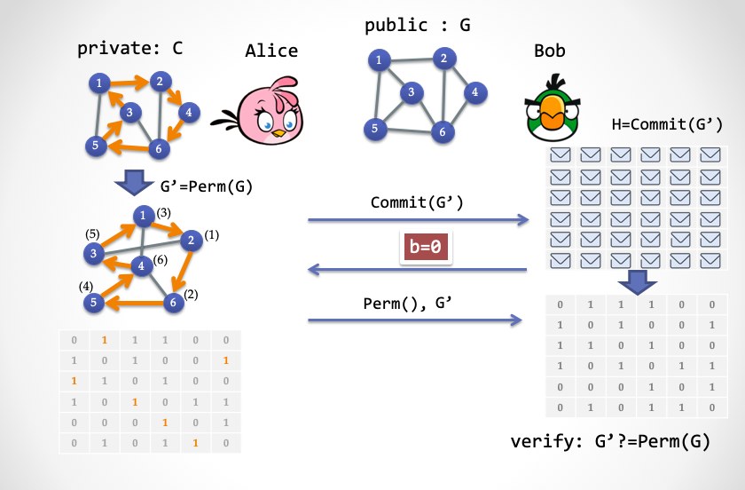

- Step three, case (1): Alice responds according to the value Bob sent. If `b = 0`, Alice sends the permutation `Perm()` and reveals the whole graph `G'`. Bob then confirms that `G'` really is `G` under that permutation.

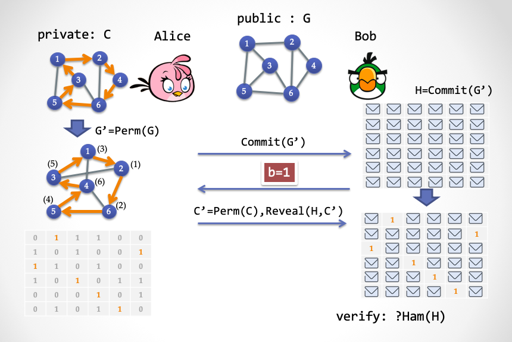

- Step three, case (2): if Bob sent `b = 1`, Alice only reveals the Hamiltonian cycle `C'` inside `G'`, and Bob checks that `C'` really is a Hamiltonian cycle.

Recall the shape of a three-step Sigma protocol, and these seemingly complicated moves become clearer:

- Step one, the *commit*: the prover Alice applies a homomorphic transformation to the answer she holds, producing a new answer, then locks every edge and hands it to Bob.
- Step two: Bob issues a random challenge.
- Step three: Alice responds in one of two ways depending on the challenge. If Bob challenges with `0`, Alice opens the commitment from step one, showing that she did not cheat there. If Bob challenges with `1`, Alice decrypts only the edges (roads) of the Hamiltonian cycle and leaves the rest sealed. Bob can then easily check whether the revealed edges form a cycle that visits every city exactly once.

If this Sigma protocol is run only once, Alice's probability of cheating is 50%; repeated `n` times, it shrinks exponentially. Try proving the protocol's zero-knowledge and soundness yourself, using the simulator and the extractor.

### A Variant: ZK-HAM-2

Now let us modify that three-step protocol. Start from a simple fact: if a subgraph `C` consisting solely of a cycle is a subgraph of `G`, that is `C <= G`, then `G` contains a Hamiltonian cycle.

This fact is equivalent to another: the complement `!G` of a Hamiltonian graph `G` is a subgraph of the complement `!C` of the cycle subgraph `C`.

> **Terminology.** The *complement* of a graph is the new map you get by keeping the vertices and swapping edges for non-edges: an edge in the old map is absent from the new one, and an edge in the new map is absent from the old one — so that overlaying the two gives a complete graph (one in which every pair of vertices is joined by an edge).

In terms of adjacency matrices: if a graph `G` contains a cycle subgraph `C`, then the set of cells that are `0` in `G` must be contained in the set of cells that are `0` in `C`. We write this as `!G <= !C`.

Using this second fact, we can define the following Sigma protocol:

- Public input: the graph `G`, as a `6*6` adjacency matrix
- Secret input: `C`, a Hamiltonian cycle in `G` (the orange roads)

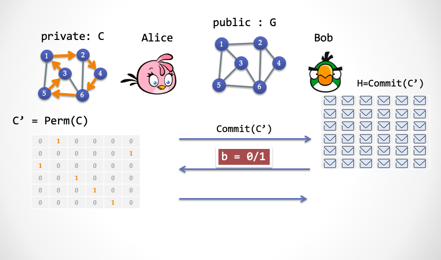

- Step one:
  - Alice picks a random permutation `Perm(.)` and builds a Hamiltonian cycle subgraph `C' = Perm(C)` from `C`;
  - Alice then encrypts every cell of `C'` and sends the ciphertexts to Bob.

- Step two: Bob picks `b in {0, 1}` at random as his challenge.

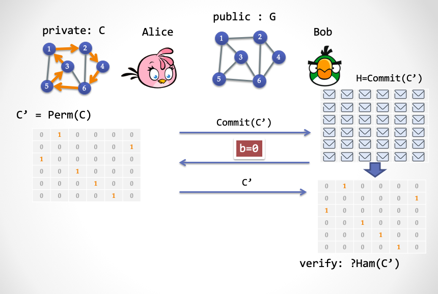

- Step three, case (1): if `b = 0`, Alice reveals the whole of `C'`, and Bob checks that `C'` really is a Hamiltonian cycle subgraph.

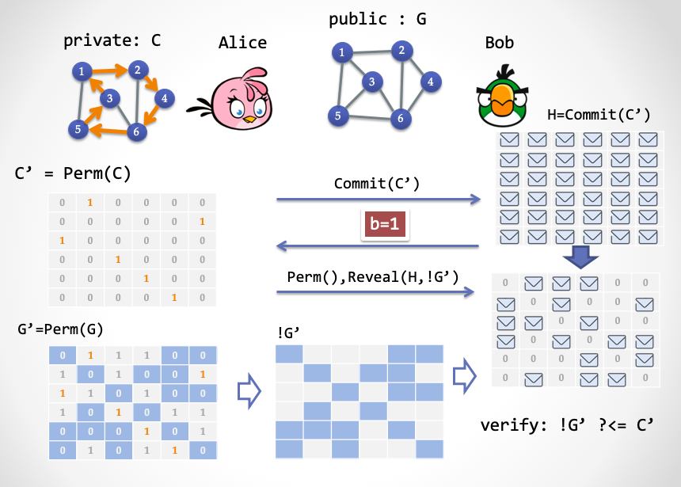

- Step three, case (2): if `b = 1`, Alice sends `Perm()` and, for every cell that is `0` in `G' = Perm(G)`, reveals the corresponding cell of `C'`. Bob checks that every revealed cell of `C'` is `0`.

Reading the three steps again:

- Step one: the prover Alice permutes the Hamiltonian subgraph `C` into a new Hamiltonian subgraph `C'`, encrypts it and hands it to Bob;
- Step two: Bob issues a random challenge, `0` or `1`;
- Step three: if Bob challenges with `0`, Alice opens the commitment from step one and exhibits a graph containing a single cycle; if Bob challenges with `1`, Alice opens the commitment at exactly the positions that are `0` in `G'` and shows that every opened position is `0`.

Now here is the key point. Look closely at step one of this new Sigma protocol. Notice anything?

**What Alice sends in step one has nothing to do with the map `G`!**

Likewise, Bob's challenge in step two has nothing to do with the map. So we can replace the commitment sent in step one with a **bit string prepared in advance**, and let us assume that this string is generated by a trusted third party. Then Bob no longer needs to send the `b = 0` branch at all, because the trusted third party is honest and will certainly have prepared a correct cycle subgraph in advance. And since Bob now only ever needs to send the `1` branch, that step can be removed too.

So the three-step protocol becomes a one-step protocol. We have removed the interaction, and NIZK is in sight.

Next we push steps one and two of `ZK-HAM-2` into a string prepared in advance, and have Alice send only the contents of step three to Bob, as in the figure:

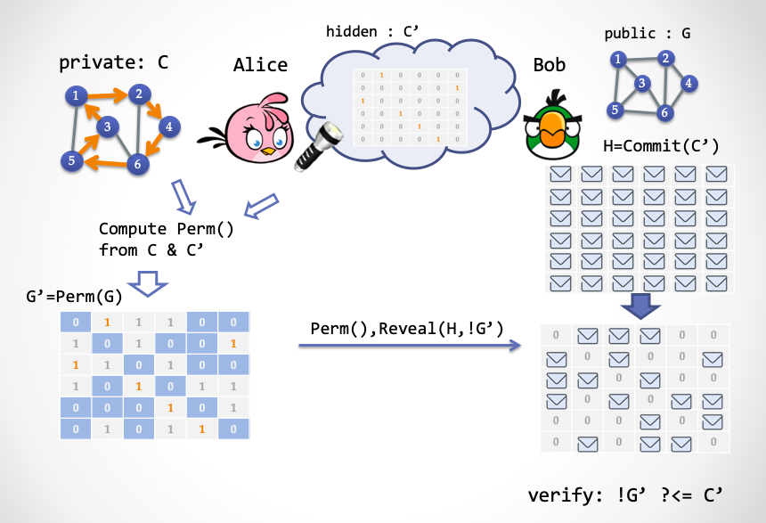

Note that this is not yet a NIZK system, because the shared string must not be public to Bob — otherwise Bob could compute the cycle `C`. Which brings us to a new concept: **hidden bits** [FLS90]. Hidden bits are a string of random bits that are hidden from the verifier Bob but visible to the prover Alice. During the proof, Alice can selectively reveal some of them to Bob. This is a powerful tool for building NIZK proof systems, and we need to go deeper.

## Secrets in the Cloud: Hidden Bits

Let us open our minds again. Imagine a cloud in the sky, and behind the cloud a string of randomly generated bits, each either `0` or `1`. Alice, the prover, wears a pair of *super spectacles* that let her see every random bit behind the cloud, but Bob, the verifier, cannot see them. Alice also holds a *super torch* whose laser can pierce the cloud, letting Bob see one bit or several. Which bits Bob gets to see is entirely Alice's choice.

The bit string hidden in the cloud is what we call **hidden bits**.

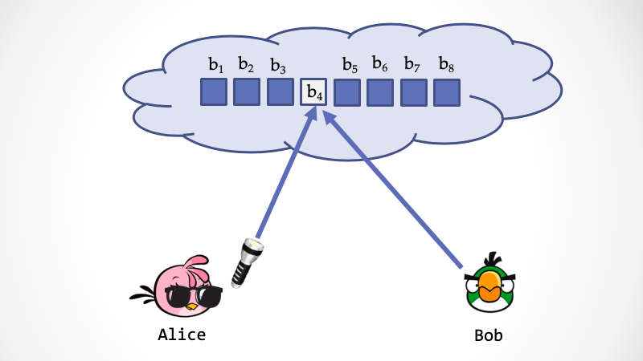

Now we use hidden bits to accomplish, in a single round, everything the `ZK-HAM-2` protocol did. In step one of `ZK-HAM-2`, Alice generates a random permutation `Perm()` and uses the Hamiltonian cycle subgraph `C` of `G` to produce a permuted cycle subgraph `C' = Perm(C)`. That is equivalent to somebody generating a random Hamiltonian cycle subgraph `C'` in advance, and Alice then computing the corresponding `Perm()` from `C` and `C'`.

Suppose some *third party* generates a random cycle subgraph `C'`, encodes it as an adjacency-matrix bit string, and puts it behind the cloud. Let `V` be the number of vertices (cities) and `E` the number of edges (roads). Encoding the adjacency matrix needs a bit string of length `V*V`, interpretable as a `V*V` matrix in which every row contains exactly one `1`, every column contains exactly one `1`, and every other cell is `0`.

How does Alice construct the proof? It is quite simple:

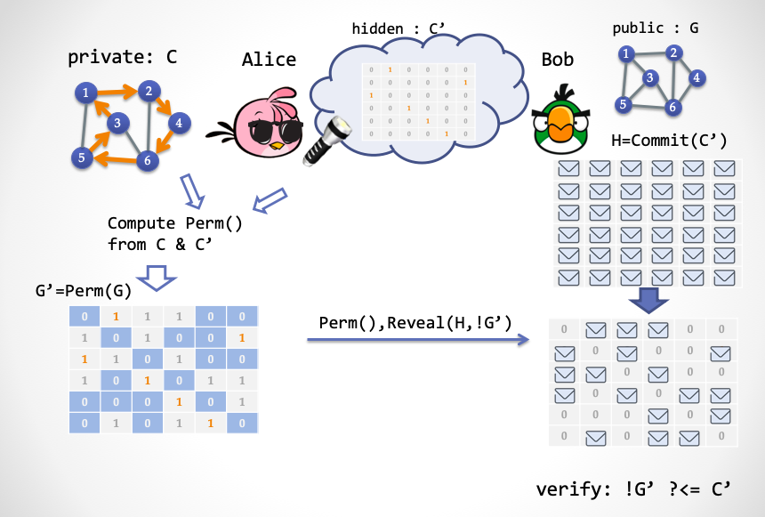

1. Through her super spectacles, Alice obtains a random Hamiltonian cycle subgraph `C'`, and computes a permutation `Perm()` such that `Perm(C) = C'`.
2. From `Perm()` Alice computes the permuted graph `G' = Perm(G)`.
3. Alice produces the proof, which has two parts: (1) the permutation `Perm()`, and (2) the values of the `C'` matrix at the coordinates of every cell that is `0` in the adjacency matrix of `G'` — which are exactly the hidden bits Alice must reveal to Bob with her super torch.

How does Bob verify it? On receiving the proof, Bob only needs to check two things:

1. That `Perm()` is a legitimate permutation `V -> V` — for instance, that no two vertices map to the same vertex.
2. That for every *non-edge* of `G`, after applying the permutation, Bob looks up at the corresponding hidden bit in the sky and finds the value `0`.

Let us look at this non-interactive protocol more carefully, starting with *completeness*: if Alice does not cheat, she obviously passes Bob's check. Please verify this for yourself.

Next, a two-step sketch of *soundness*. First, because Bob's check tells him that the whole permuted non-edge set of `G` has been revealed and is entirely `0`, he can conclude that `!G <= !C` — the non-edge set of `G` is a subset of the non-edge set of the cycle subgraph `C`. That is equivalent to `C <= G`, i.e. `G` contains a Hamiltonian cycle. Note that soundness here holds with probability 100%.

Second, imagine an Ideal World in which Bob acquires a superpower — say, Alice's super spectacles — so that he can see through the cloud and read all the hidden bits `C'` without needing Alice's torch. Once Bob has `Perm()`, he can invert it to recover `C`, and Bob has effectively become an *extractor*: in the Ideal World he successfully extracts the knowledge Alice was proving.

And how do we prove *zero knowledge*? Alice needs a superpower of her own: in the Ideal World, she can secretly modify the hidden bits in the cloud. After that it is easy — the simulator Zlice deceives Bob like this:

1. Zlice sets every hidden bit in the cloud to `0`.
2. Zlice generates a legitimate `Perm()` at random.

You will have spotted the catch: the bits hidden in the sky must be a *trustworthy* string, meaning that it really must be a Hamiltonian cycle subgraph. So the third party must be trusted.

But isn't such a third party rather unsatisfactory? Alice and Bob have to trust it absolutely not to collude with their opponent. If it colludes with Alice, it can simply set the hidden bit string to all `0`s; if it colludes with Bob, it can just show Bob the string. The protocol looks fine, but it is hard to use in practice. Let us now upgrade it.

## Upgrading the Randomness

The first upgrade is to make the hidden bit string a *uniformly distributed* random string — a string that genuinely looks random — rather than a deliberately arranged Hamiltonian subgraph.

Fully random means the number of `0`s and the number of `1`s occur with roughly equal probability. The next difficulty is how to make a random Hamiltonian cycle subgraph matrix appear inside a random bit string. The method is crude but effective: generate a long enough random string, then scan from the beginning until you find a random Hamiltonian cycle.

But... isn't the probability of success extremely small? Here is a search method whose probability is not so small.

1. Cut the bit string into chunks of length `5log(V)`. If every bit in a chunk is `1`, treat that chunk as a cell of value `1` in the adjacency matrix; otherwise treat it as a cell of value `0`. Each matrix cell is then `1` with probability `1/(V^5)`.
2. Take `V^6` consecutive chunks and arrange them into a large `V^3 * V^3` matrix. If the large matrix contains a `V*V` Hamiltonian cycle matrix and all its other cells (`V^6 - V^2` of them) are `0`, we call the large matrix **useful**.
3. A probability calculation shows that a useful matrix appears with probability `1/[V^(3/2)]`.

*Note: for the derivation of the probability of a "useful" matrix, see Fact 4.10.8 in Oded Goldreich, "Foundations of Cryptography, Vol. I", p. 304.*

Now we need to upgrade the protocol from the previous section, because the hidden bit string has been carved into a number of large matrices, some of them useful and some not.

Alice sets about constructing her proof. She puts on her super spectacles and scans the hidden bits in the cloud, and there are two cases:

+ Case 1: Alice reaches a useless large matrix `M`. She reveals every cell of `M`.
+ Case 2: Alice reaches a *useful* large matrix `M`. This means she has obtained a random Hamiltonian cycle `C'`, and she proceeds exactly as in the previous section.

And how does Bob verify? Again there are two cases:

+ Case 1: if Alice revealed the whole of `M`, Bob checks that `M` really is *useless*. If it is, the proof is accepted for that matrix; otherwise it is rejected.
+ Case 2: if Alice sent a proof of the form (`Perm()`, `X`), Bob verifies it as in the previous section.

With this protocol, Bob no longer has to worry that the third party might cheat by deliberately producing an all-zero bit string. But Alice still has to worry that if the third party colludes with Bob, the knowledge leaks completely.

There is a further strong limitation: Alice must not be allowed to choose the `G` she wants to prove *after* seeing the hidden bits, or she can cheat. A prover whose choice of statement is independent of the CRS is called a *non-adaptive adversary*.

## The FLS Transform: From Hidden Bits to NIZK

Now we upgrade the protocol again, removing the hiddenness from the hidden bit string and turning it into an ordinary common reference string. For this we need a cryptographic tool: the **trapdoor permutation**.

A trapdoor permutation is a permutation function `F(x)` where `x` is an element of a set `S`, and `F(x)` maps `x` to another element `y` of `S`. `F` is one-way: recovering `x` from `y` is hard. But anyone holding the trapdoor `t` can compute the inverse, `F^(-1)(t, y) = x`. A trapdoor permutation can also be paired with a *hardcore predicate* `h(x) = 0/1`, which produces a uniformly distributed `0/1` bit from an element of `S`. That is the whole introduction — a bit dizzying, perhaps, but you get used to it. In one sentence: a trapdoor permutation lets us convert back and forth between a common reference string and hidden bits.

Assume we have such a tool, and let us upgrade the protocol.

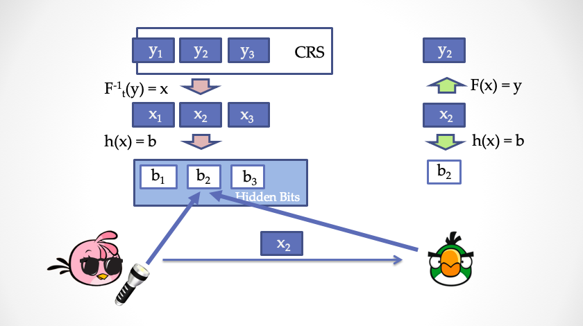

Think of the common reference string as a list `y1, y2, y3, ..., yn`, each item an element of `S`. Then use the hardcore predicate to produce each bit of the hidden bits. Note that we cannot produce the hidden bits directly as `h(y) = b`, because then Bob could compute all the hidden bits himself, violating the protocol of the previous section. To keep them hidden from Bob, we produce the hidden bits from the *preimages* of the common reference string — `x1, x2, x3, ..., xn` — as `h(x) = b`. Bob cannot compute `b1, b2, b3, ..., bn` himself, but once he is given some `x` he can check `F(x) ?= y` to confirm that `x` corresponds to the common reference string, and then compute `h(x) = b` to obtain the revealed hidden bit `b`.

Here is a less precise but more intuitive way to see it. Alice effectively generates a key pair of her own. She then treats the common reference string as a piece of *ciphertext*; because she has the private key she can decrypt it and obtain plaintext, and that plaintext is, from Bob's point of view, the hidden bits. When Alice wants to *reveal* a hidden bit she produces the corresponding plaintext fragment together with the public key, and Bob re-encrypts the plaintext with the public key and compares it against the common reference string, making sure Alice did not cheat while revealing.

The upgraded protocol:

**For the prover Alice:**

1. Alice picks a trapdoor permutation `(F, h, t)` at random.
2. For each `yi` in the common reference string, she uses the trapdoor to invert: `xi = F^(-1)(t, yi)`.
3. She computes the hidden bits, `bi = h(xi)`.
4. She produces the proof as in the previous section. If the positions of the hidden bits she needs to reveal are `r1, r2, ..., rl`, then Alice sends Bob the corresponding `x` values, `x_r1, x_r2, x_r3, ..., x_rl`, together with `(F, h)` and the proof.

**For the verifier Bob:**

1. Bob checks that `(F, h)` is a legitimate trapdoor permutation.
2. For each element `x_r` in the list, he computes the revealed hidden bit `bi = h(F(x_r))`, and then checks the proof as in the previous section.

Please check completeness of this new protocol for yourself.

For *zero knowledge* we need to construct a simulator, Zlice2, whose superpower is modifying the common reference string.

1. The simulator calls the previous section's simulator Zlice directly, obtaining a triple `(proof, {r}, {b})`.
2. For each position of the common reference string, if it corresponds to some `r`, the simulator picks `x_r` **at random** from `S` such that `h(x_r) = b_r`, where `b_r` is the element of `{b}` corresponding to `r`; then it uses `y_r = F(x_r)` as that part of the fake reference string.
3. For each position unrelated to `{r}`, the simulator simply picks a random `y`.
4. The simulator concatenates all the `y` values into a fake CRS.

*Soundness* is less straightforward. Alice now gets to choose `(F, h, t)`, and she may choose one that favours her — even one that lets her cheat — controlling the hidden bits `{b}` for one run of the protocol. So the upgraded protocol has to be repeated many times, so that although Alice can control the hidden bits of a single run, she is powerless over the hidden bits of the other runs. In other words, no choice of `(F, h, t)` gives Alice full control over many runs.

In theory this upgrade supports any non-interactive zero-knowledge proof in the hidden-bits model, and it is known as the FLS protocol. The FLS transform brings several benefits. First, the randomly generated CRS can be reused many times, giving so-called *multi-theorem NIZK*. Second, it achieves *adaptive soundness*: Alice may see the CRS first and only then choose what to prove. Finally, the protocol is also *adaptive zero-knowledge*: Bob too may see the CRS first and only then choose what he wants proved.

*Note: adaptive adversaries model real-world security better — CCA2 security is another example. Because the CRS is public, an attacker can analyse it first and only then decide how to mount an attack.*

## In Search of an Ideal Trapdoor Permutation

Trapdoor permutations first appeared in Andrew Yao's paper "Theory and Application of Trapdoor Functions" [Yao82], and they are a cornerstone of public-key cryptography. The FLS transform of the previous section needs an *idealised* trapdoor permutation, meaning that every n-bit string maps uniquely to another n-bit string with no many-to-one collisions. Alice has to sample an index at random and send it to Bob, and Bob must be able to check that the `F()` corresponding to that index is a *perfect* permutation. Here is the problem: how can Bob check that in polynomial time? If Bob cannot check it, Alice can sample an imperfect permutation — a many-to-one function, say — and potentially cheat, destroying soundness. Bellare and Yung noticed this in a 1996 paper, but did not fully solve it [BY96].

Finding a bridge that abstracts trapdoor permutations appropriately while still connecting to real cryptographic implementations is an extremely challenging piece of work. Cryptographers — Oded Goldreich among them — studied it for a long time afterwards and published a great many papers; various different kinds of trapdoor permutation were defined and studied, and none was quite satisfactory. Only recently, in 2018, did Ran Canetti and Amit Lichtenberg introduce a new class, the certifiable injective trapdoor function [RL18], and prove that this kind of trapdoor permutation finally meets the requirements of the FLS transform. Is that the end of the story? Theoretical cryptographers are unlikely to stop exploring.

Besides the trapdoor-permutation-based FLS transform, there are various other ways to upgrade the hidden-bits model: invariant signatures [BG90], verifiable random generators [DN00], weak verifiable random functions [BGRV09], and a scheme based on publicly verifiable trapdoor predicates [CHK03].

In thirty years cryptographers have invented many NIZK schemes, but the hidden-bits method remains the only known approach that (1) rests on a *uniformly distributed* shared CRS and (2) yields NIZK **proofs** — not arguments — for arbitrary NP languages.

## NIZK Proofs vs. NIZK Arguments

The NIZK *proof* systems we have constructed in this article have **statistical soundness** and **computational zero-knowledge**. What does that mean? It means that no matter how powerful the prover Alice's computation is — even super-polynomial — she still cannot cheat. But if the verifier Bob has enormous computing power, it is possible that Bob extracts valuable *knowledge* from the proof.

And what does *that* mean?

It means that for NIZK proofs the proof must be longer than the knowledge — the `witness` of the `NP` problem. Given enough computing power, Bob can decrypt the proof. And the extractor, too, must be able to extract the `witness` without any interaction. The shortest NIZK proofs known are those built by Craig Gentry and co-authors using fully homomorphic encryption [GGI+14], where the proof is only slightly longer than the witness.

Can we construct a NIZK whose proof is *shorter* than the witness? Yes!

There is another class of NIZK systems, called **NIZK arguments**. Their soundness is *computational*, and their zero knowledge is *perfect* or *statistical*. This means that if Alice has enormous computing power she does have room to cheat — but in the real world we can raise the security parameters to make her chance of cheating negligible, while achieving extremely strong zero-knowledge. Having weakened soundness, we can go on compressing the proof size.

*Note: in this series we do not go out of our way to distinguish "proof" from "argument". Where we need to mean arguments specifically rather than proofs, we say so.*

Suppose we publish a NIZK proof on GitHub. A hundred years from now, if GitHub still exists and computing power has taken a qualitative leap, a NIZK *proof* might be broken by brute force and leak its knowledge, whereas a NIZK *argument* would very likely still be secure.

The `AR` in the fashionable term zkSNARK stands for exactly this: **argument**.

NIZK arguments can achieve proofs of constant size, `O(1)` — independent of the length of the `witness`. But that requires burying more secrets in the CRS.

## A World Without Secrets

In 1956, Gödel raised a famous question in a letter to von Neumann: is P equal to NP? The question was later named one of the Clay Institute's seven Millennium Prize Problems, with a million dollars attached.

Zero-knowledge proof systems exist to verify `NP` statements while keeping the witness from leaking. So what would it mean if someone proved `P == NP`? It would mean the witness no longer matters much, since a Turing machine could find the witness in polynomial time anyway. The witness that zero-knowledge proofs try to protect would become pointless to protect.

In fact, if `P == NP`, the hard problems underlying today's public-key cryptography, symmetric ciphers such as AES and SM4, and hash algorithms could all collapse, and it might become very difficult to keep any secret at all. And more than that:

> If P = NP, then the world would be a profoundly different place than we usually assume it to be. There would be no special value in "creative leaps", no fundamental gap between solving a problem and recognizing the solution once it's found. Everyone who could appreciate a symphony would be Mozart; everyone who could follow a step-by-step argument would be Gauss; everyone who could recognize a good investment strategy would be Warren Buffett. It's possible to put the point in Darwinian terms: if this is the sort of universe we inhabited, why wouldn't we already have evolved to take advantage of it?
> 
> — Scott Aaronson (2006)

The same applies to mathematics: verifying a mathematical proof is a polynomial-time process, so if `P == NP` there would exist a polynomial-time algorithm for *finding* proofs, when they exist. That means Goldbach's conjecture and the Riemann hypothesis might well be proved — no wonder Lance Fortnow wrote on his blog [For04]:

> A person who proves P == NP would walk home from the Clay Institute not with one million-dollar check but with seven.
> 
> — Lance Fortnow (2004)

A 2002 survey found that 61% of computer scientists believed `P != NP`; ten years later the figure had risen to 83% [Wil12]. I was myself persuaded by the following argument from Scott Aaronson:

> The self-referential argument: if P = NP were true, the proof would be relatively easy to find; whereas if P != NP, the proof would be relatively hard to find. So believing P != NP seems to make *mathematical reality* more self-consistent.
> 
> — Scott Aaronson (2006)

Reluctantly, then: if we really did live in a world without secrets, what would it look like? The **Panopticon** is a chilling idea proposed by the eighteenth-century English philosopher Jeremy Bentham. The prisoners are watched from the centre around the clock, with no privacy whatsoever, and they cannot even know whether they are being watched at any given moment. It is a thoroughly bleak conception, and profoundly uncomfortable — but many people regard it as an uncannily accurate two-hundred-year-old parable of our networked digital age.

From *Billy Budd*, through Kafka's *The Trial*, to Orwell's *1984*, to the hacker Kevin Mitnick's bestseller *The Art of Invisibility* (which teaches you how to protect your own information in the age of big data) — danger everywhere, risk accumulating, and imagined apocalypses supplying writers with excellent material.

I once came across an interesting comic, *The Private Eye*, which paints a post-apocalyptic scene. In the future, all our data lives in the cloud; then one day, for reasons nobody knows, the cloud *explodes*. (Perhaps someone carelessly opened Pandora's box and found a constructive proof that `P == NP`.) At any rate, all information — including everyone's darkest past — stops being secret; every digital asset is wiped; every online knowledge base is lost forever. Everyone's words and deeds, bills, emails, chat messages, bank card PINs, school exam papers, GPS traces, half-written diaries, deleted photos and browsing history are exposed to colleagues, neighbours, friends, relatives, and any curious stranger.

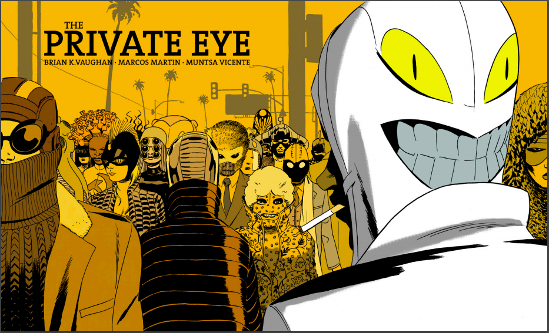

Nobody can face anyone else; everyone lives in dread. Gradually people choose to hide. They wear masks when they go out, carefully guarding their identity; a person may even choose to use several identities. The law punishes any act of prying severely, obtaining information becomes a supreme power, cameras are strictly controlled, the internet no longer exists, and communication returns to the age of the phone booth.

Is this humanity's ultimate fate?

## To Be Continued

At the start of this article we said that hidden randomness is not strictly necessary, so let us revisit the hidden-bits model. Those hidden bits are not hidden from the prover at all — the prover sees them openly. But because the hidden bits are a *uniformly distributed random* string, the prover still cannot escape the firepower of the random challenge even knowing them. In the popular zkSNARK schemes, however, the CRS is not uniformly random but a set of *structured* random values. Either way, the secret behind using a CRS to build a foundation of trust is precisely the *secret* buried inside it.

This matches intuition: keeping a secret is also a form of trust. Because Alice does not know the secret back door hidden in the CRS, she cannot cheat. Equally, because Bob does not know the secret in the CRS, he cannot obtain the knowledge. In the same way, cooperation between people has to be built both on openness and on keeping certain things secret.

> All human beings have three lives: public, private, and secret.
> 
> — Gabriel García Márquez

*Acknowledgments: thanks to Yu Chen, Shengchao Ding, Yupeng Zhang, Honggang Hu, Weiran Liu, Debiao He and Zhiguo Wan for their expert advice and corrections, and to the SECBIT Labs team (p0n1, even, valuka, Vawheter, yghu, mr) for their suggested revisions. The content of this article does not represent their views.*

Finally, here is a link to the comic: [http://panelsyndicate.com/comics/tpeye](http://panelsyndicate.com/comics/tpeye). The authors have even released the emails and sketches from the creative process, so you can enjoy the pleasure of peeking behind the scenes.

### References

+ [Aar06] Aaronson, Scott. *Reasons to believe*, 2006. https://www.scottaaronson.com/blog/?p=122
+ [BFM88] Blum, Manuel, Paul Feldman, and Silvio Micali. "Non-interactive zero-knowledge and its applications." STOC'88. 1988.
+ [BG90] Bellare, Mihir, and Shafi Goldwasser. "New paradigms for digital signatures and message authentication based on non-interactive zero knowledge proofs." *Conference on the Theory and Application of Cryptology*. Springer, New York, NY, 1989.
+ [BGN05] Boneh, Dan, Eu-Jin Goh, and Kobbi Nissim. "Evaluating 2-DNF formulas on ciphertexts." *Theory of Cryptography Conference*. Springer, Berlin, Heidelberg, 2005.
+ [BGRV09] Brakerski, Zvika, Shafi Goldwasser, Guy N. Rothblum, and Vinod Vaikuntanathan. "Weak verifiable random functions." In *Theory of Cryptography Conference*, pp. 558-576. Springer, Berlin, Heidelberg, 2009.
+ [BY96] Bellare, Mihir, and Moti Yung. "Certifying permutations: Noninteractive zero-knowledge based on any trapdoor permutation." *Journal of Cryptology* 9.3 (1996): 149-166.
+ [CHK03] Canetti, Ran, Shai Halevi, and Jonathan Katz. "A forward-secure public-key encryption scheme." *International Conference on the Theory and Applications of Cryptographic Techniques*. Springer, Berlin, Heidelberg, 2003.
+ [CHMMVW19] Chiesa, Alessandro, et al. *Marlin: Preprocessing zkSNARKs with universal and updatable SRS*. Cryptology ePrint Archive, Report 2019/1047, 2019, https://eprint.iacr.org/2019/1047.
+ [DN00] Dwork, Cynthia, and Moni Naor. "Zaps and their applications." *Proceedings 41st Annual Symposium on Foundations of Computer Science*. IEEE, 2000.
+ [FLS90] Feige, Uriel, Dror Lapidot, and Adi Shamir. "Multiple non-interactive zero knowledge proofs based on a single random string." *Proceedings [1990] 31st Annual Symposium on Foundations of Computer Science*. IEEE, 1990.
+ [For04] Fortnow, Lance. "What if P = NP?". 2004. https://blog.computationalcomplexity.org/2004/05/what-if-p-np.html
+ [For09] Fortnow, Lance. "The status of the P versus NP problem." *Communications of the ACM* 52.9 (2009): 78-86.
+ [Groth10a] Groth, Jens. "Short non-interactive zero-knowledge proofs." *International Conference on the Theory and Application of Cryptology and Information Security*. Springer, Berlin, Heidelberg, 2010.
+ [Groth10b] Groth, Jens. "Short pairing-based non-interactive zero-knowledge arguments." *International Conference on the Theory and Application of Cryptology and Information Security*. Springer, Berlin, Heidelberg, 2010.
+ [GOS06] Groth, Jens, Rafail Ostrovsky, and Amit Sahai. "Perfect non-interactive zero knowledge for NP." *Annual International Conference on the Theory and Applications of Cryptographic Techniques*. Springer, Berlin, Heidelberg, 2006.
+ [GWC19] Gabizon, Ariel, Zachary J. Williamson, and Oana Ciobotaru. *PLONK: Permutations over Lagrange-bases for Oecumenical Noninteractive arguments of Knowledge*. Cryptology ePrint Archive, Report 2019/953, 2019.
+ [KP98] Kilian, Joe, and Erez Petrank. "An efficient noninteractive zero-knowledge proof system for NP with general assumptions." *Journal of Cryptology* 11.1 (1998): 1-27.
+ [MBK+19] Maller, Mary, et al. "Sonic: Zero-Knowledge SNARKs from Linear-Size Universal and Updateable Structured Reference Strings." *IACR Cryptology ePrint Archive* 2019 (2019): 99.
+ [RL18] Ran Canetti and Amit Lichtenberg. "Certifying trapdoor permutations, revisited." *Theory of Cryptography Conference*. Springer, Cham, 2018.
+ [Wil12] Gasarch, William I. "Guest Column: The Third P=? NP Poll." *ACM SIGACT News* 50.1 (2019): 38-59.
+ [Yao82] Yao, Andrew C. "Theory and application of trapdoor functions." *23rd Annual Symposium on Foundations of Computer Science (sfcs 1982)*. IEEE, 1982.
